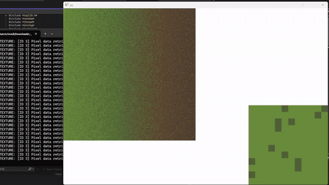
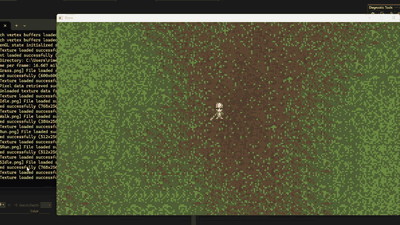
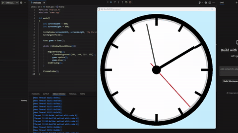
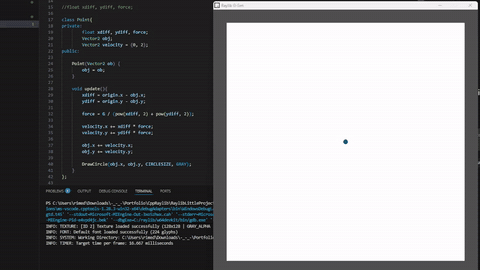
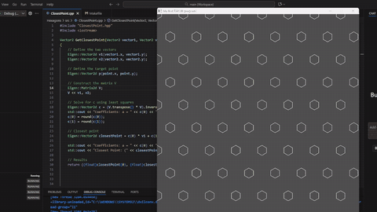
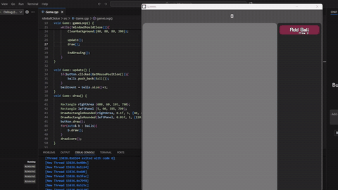
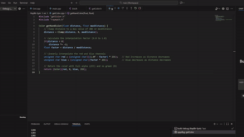
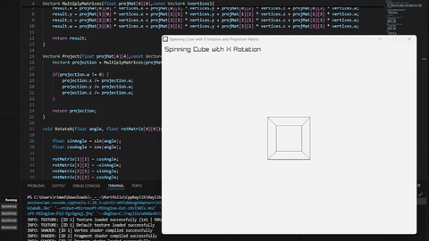
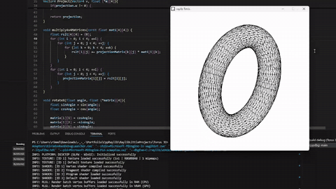

# C++ using Raylib graphics API

## SpriteProgramming
  

- External files include header files for PerlinNoise, used in one of the projects.
- The Grass file generates an image: a random four-color pixel gradient that’s used in the TileGrid project.

### TileGrid

This project procedurally generates ground using Perlin noise and the image created in the Grass project. It also includes sprite animation.

- **Short Video**:

## RaylibLittleProjects

### Clock

- **Short Video**:  

A simple geometric implementation representing a mechanical clock, using 2D rotation and transformation.

### Gravity_Sim

- **Short Video**:  

A program that simulates gravity for objects placed around a central point.

### Hexagons

- **Short Video**:
- 

Hexagons are arranged in a perfect grid; the size can be changed in real time.

### IdleBallClicker

- **Short Video**:
- 

A simple idle game simulation: each time the ball touches the boundary, the score increases. A single button displays the ball price and adds another ball to the game.

### Raylib-Spin

- **Short Video**:  

Random balls spawn and spin around a center point, gradually changing color and disappearing as they reach the center.

### Simple_3D_Cube 

- **Short Video**:
- 

This program draws a 3D cube representation that can be rotated in real time.

### Torus 3D

- **Short Video**:

A 3D torus projection using a mesh .txt file. The projection can be rotated using the J, K, and L keys.
