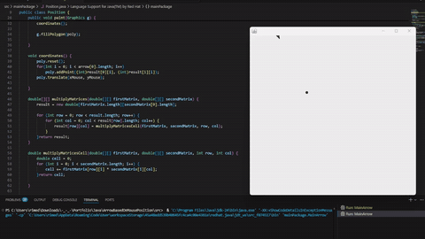
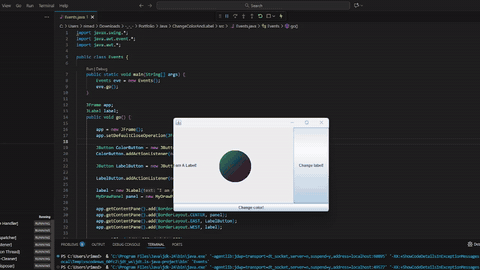
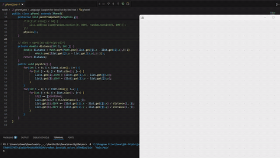
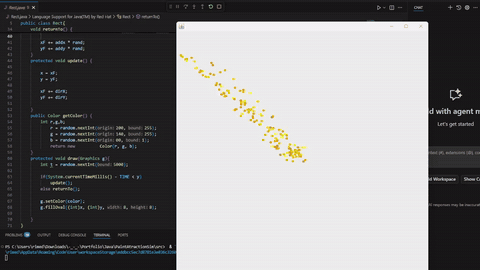
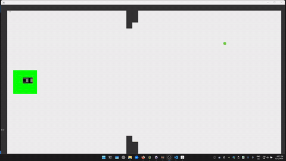
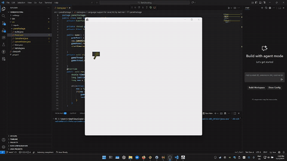
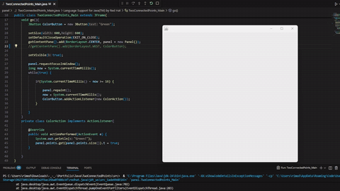

# Screenshots with short descriptions

## Java, java.awt and javax.swing

### ArrowBasedOnMousePosition

- **Tech**: Java SE  
- **Highlights**:  
  - Real-time arrow rotation with `AffineTransform`  
  - Smooth mouse capture via `MouseMotionListener`  
- **Short Video**:  

Program tracks mouse position; when pressed, the polygon pointing to the center object is added to the array, then iterates and draws it on the screen.

### ChangeColorAndLabel
- **Short Video**:

Randomly changes colors of the circle.

### GravitySim
- **Short Video**:  

Simulates gravitational attraction between objects in real time; objects can be added with a mouse click.

### PaintAtractionSim
- **Short Video**:  

Small little circles are spawned at the click point with different initial velocities that follow the mouse position and disappear when they get close enough.

### Probably_THE_Game
- **Short Video**:  

Game objective is to collect the green dot on the right side of the screen and drive the car with the collected gem to the left side area. Map obstacles are updated after every scored point.

### TankShooting
- **Short Video**:  

Turret follows the mouse position and rotates accordingly; when pressed, it shoots a series of bullets. The tank can be controlled with WASD keys.

### TwoConnectedPoints
- **Short Video**:  

When the mouse is clicked, a point is placed on the screen and when released, the second point is placed; both are connected with a line.
